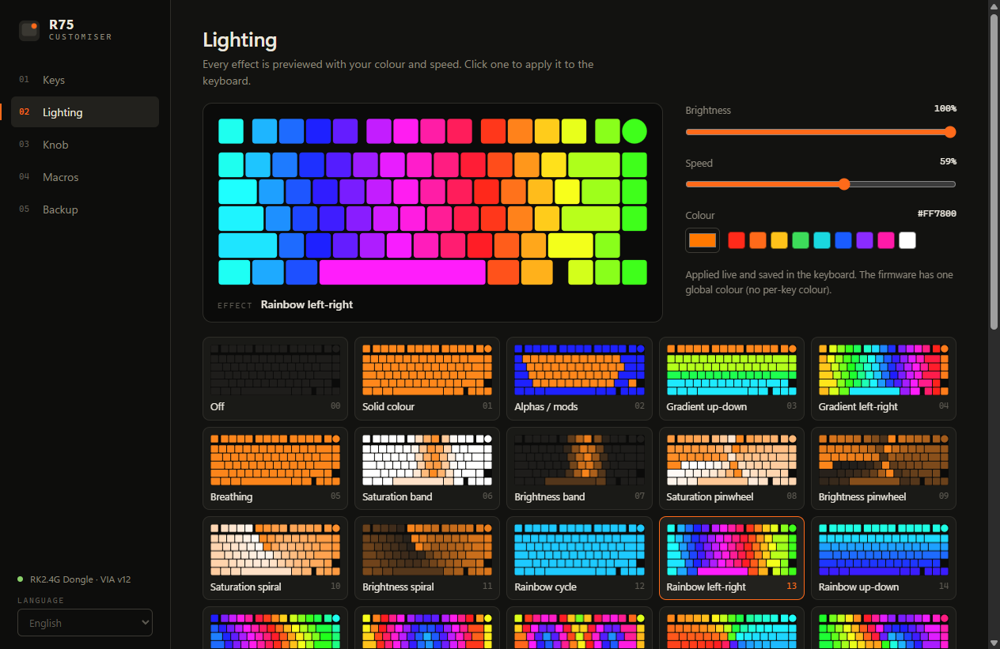
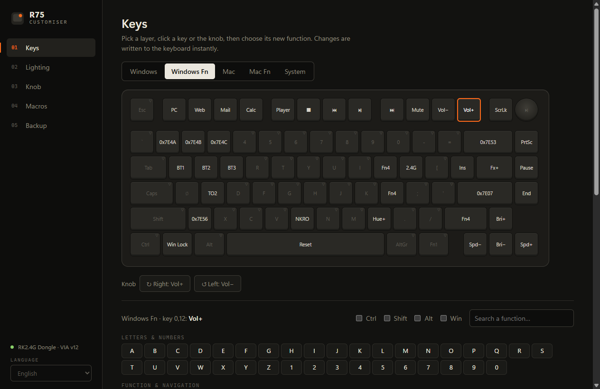
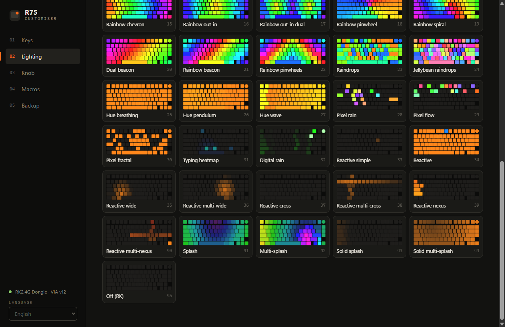
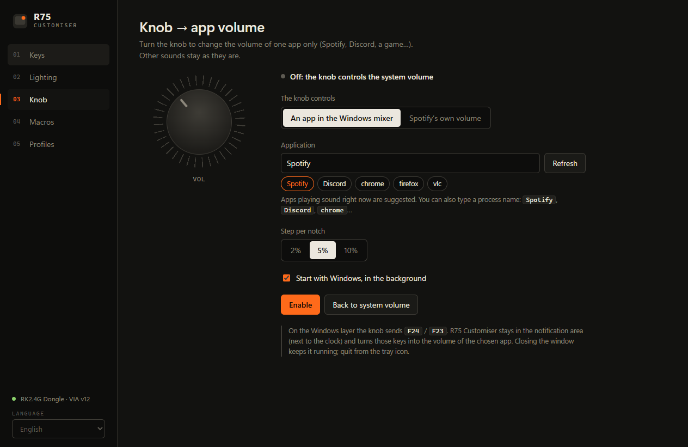
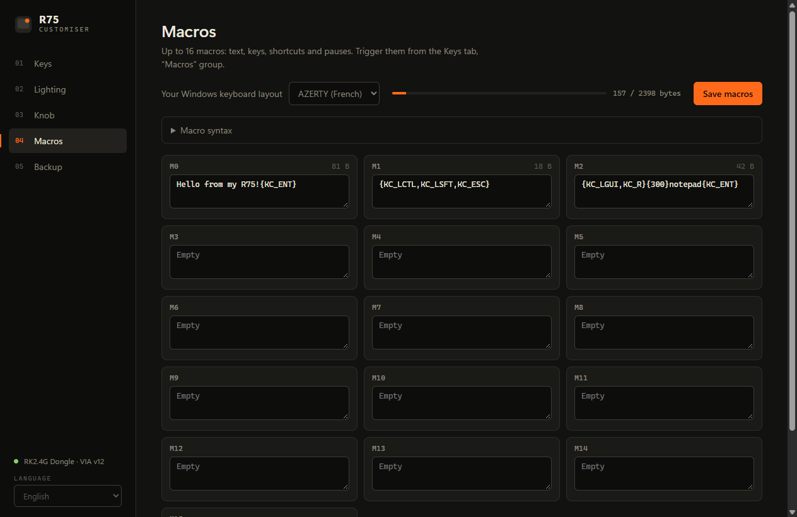
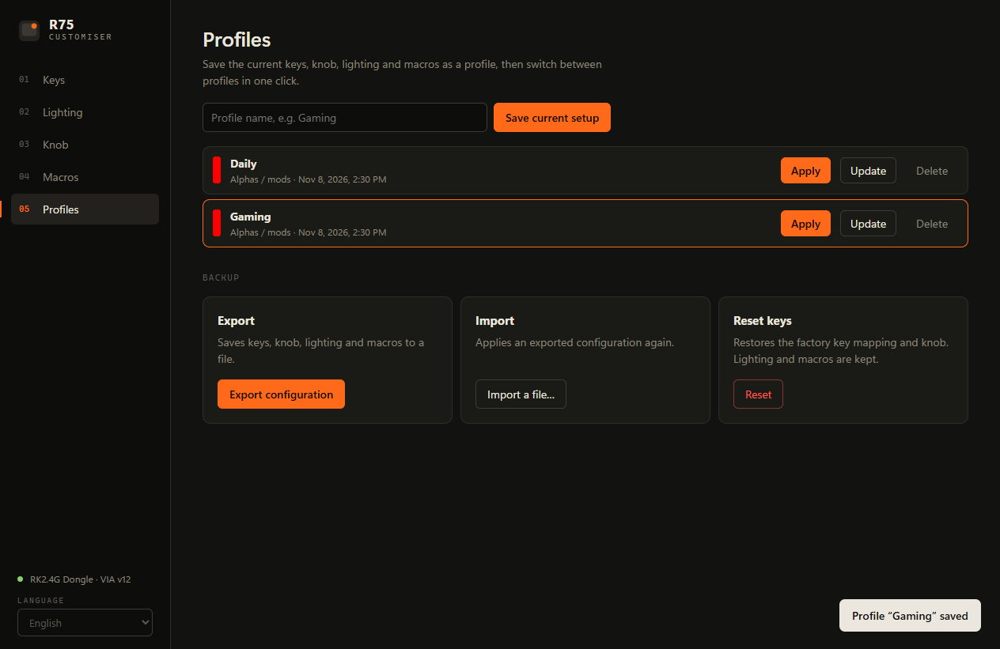
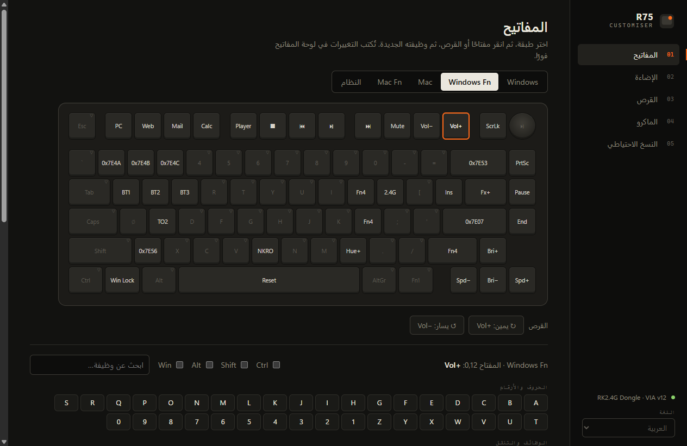
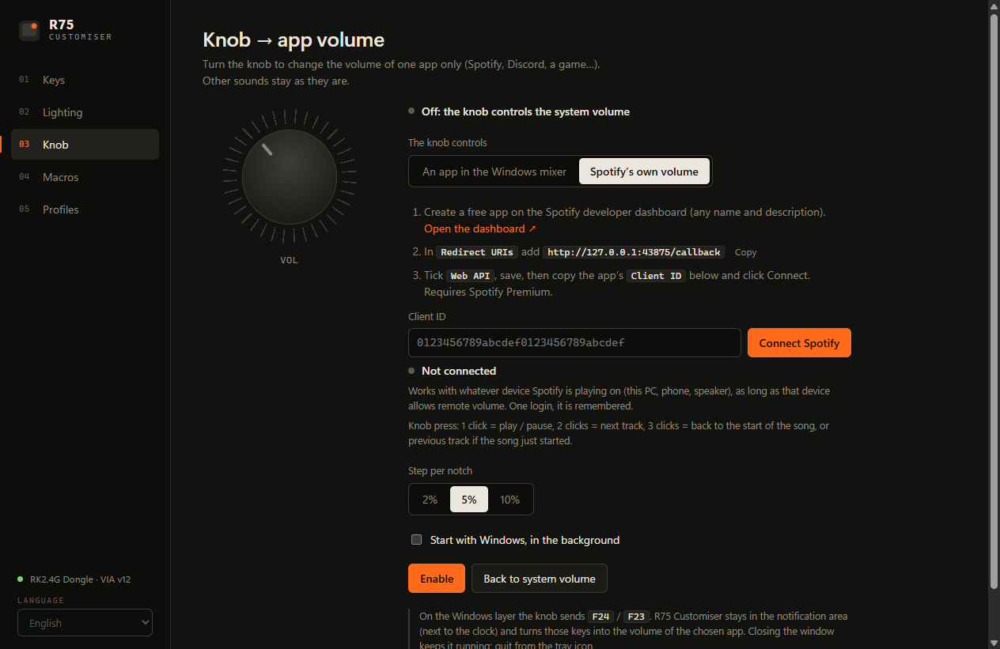

<p align="center">
  
</p>

<h1 align="center">R75 Customiser</h1>

<p align="center">
  <b>Configurateur rapide et hors ligne pour le clavier Royal Kludge R75.</b><br>
  Remappe les touches et les raccourcis Fn, prévisualise les 46 effets lumineux, écris des macros,<br>
  et transforme la molette en bouton de volume pour une seule application, comme Spotify.
</p>

<p align="center">
  <a href="../../releases/latest"></a>
  
  
  
</p>

<p align="center"><a href="README.md">Read in English</a></p>

<p align="center">
  
</p>

## Pourquoi

Le configurateur web officiel de RK est lent, demande un navigateur et ne détecte souvent même pas le clavier. R75 Customiser tient dans un seul `.exe` portable : tu branches le clavier, tu ouvres l'app, il est trouvé tout de suite. Pas de compte, pas d'installation, pas d'internet.

## Fonctions

| | |
|---|---|
| **Touches** | Remappe n'importe quelle touche sur les 5 couches (Windows, Windows + Fn, Mac, Mac + Fn, Système) : raccourcis comme `Ctrl + Maj + Échap`, touches média, couches, éclairage, macros et fonctions sans fil RK (BT1 à BT5, 2.4 GHz, USB). |
| **Raccourcis Fn** | Choisis la couche *Windows Fn* et donne à chaque `Fn + touche` l'action que tu veux. Les touches transparentes affichent ce qu'elles héritent. |
| **Éclairage** | Les 46 effets du firmware, chacun avec un aperçu animé à ta couleur. Les aperçus sont ralentis et ne s'animent qu'au survol, pour rester doux pour les yeux (le réglage Windows *réduire les animations* est respecté). Clique un aperçu pour l'appliquer. Luminosité, vitesse et couleur changent le clavier en direct et y sont enregistrées. |
| **Molette → volume d'une app** | Tourne la molette pour régler le volume d'une seule application (Discord, un jeu, un navigateur...) dans le mélangeur de volume Windows, ou pilote **la barre de volume interne de Spotify** via l'API Web Spotify. Une petite barre à l'écran affiche le niveau. Les autres sons ne bougent pas. |
| **Macros** | 16 macros mêlant texte, touches, combinaisons et pauses. Le texte est converti pour un Windows en AZERTY français ou en QWERTY US, accents compris. |
| **Profils** | Enregistre la config actuelle (touches, molette, éclairage, macros) dans des profils nommés comme *Travail* ou *Jeu* et passe de l'un à l'autre en un clic. Seules les différences sont écrites dans le clavier. |
| **Sauvegarde** | Exporte toute la configuration en JSON et restaure-la plus tard, ou remets les touches d'usine. |
| **5 langues** | English, Français, Español, Deutsch et العربية (interface entièrement de droite à gauche). |

## Captures

<table>
  <tr>
    <td></td>
    <td></td>
  </tr>
  <tr>
    <td></td>
    <td></td>
  </tr>
  <tr>
    <td></td>
    <td></td>
  </tr>
</table>

## Démarrer

1. Télécharge sur la page [Releases](../../releases/latest) : `R75-Customiser-x.y.z.exe` pour Windows (portable, rien à installer) ou `R75-Customiser-x.y.z-mac.dmg` pour macOS (Intel et Apple Silicon).
2. Branche le clavier avec le **dongle 2.4 GHz** ou le **câble USB**. Le mode Bluetooth ne permet pas la configuration (le firmware n'expose pas son interface de configuration en Bluetooth).
3. Lance l'app. Le clavier est détecté automatiquement.

> **Windows SmartScreen** peut afficher un avertissement au premier lancement car l'app n'est pas signée. Clique sur *Informations complémentaires*, puis *Exécuter quand même*.

> **macOS** : ouvre le `.dmg` et glisse *R75 Customiser* dans *Applications*. L'app n'est pas notariée par Apple, le premier lancement est donc bloqué : ouvre *Réglages Système → Confidentialité et sécurité*, descends et clique sur *Ouvrir quand même* (ou lance `xattr -cr "/Applications/R75 Customiser.app"` dans le Terminal).

Clavier sans fil en veille ? Appuie sur une touche, puis clique sur *Rechercher le clavier*.

## Molette → volume d'une app

Deux modes, à choisir en haut de l'onglet **Molette** :

**Une app du mélangeur Windows** (n'importe quelle app)

1. Lance de la musique (ou un son) dans l'application à piloter.
2. Choisis l'application (celles qui jouent du son sont proposées) et le pas par cran.
3. Clique sur **Activer**.

**Le volume interne de Spotify** (Spotify Premium)

Déplace la barre de volume de Spotify lui-même, sur l'appareil qui joue (ce PC, un téléphone, une enceinte), au pourcent près et sans faire passer Spotify au premier plan.

1. Ouvre le [tableau de bord développeur Spotify](https://developer.spotify.com/dashboard) et crée une app (nom et description au choix).
2. Ajoute l'URI de redirection `http://127.0.0.1:43875/callback`, coche **Web API** et enregistre.
3. Copie le **Client ID** de l'app dans R75 Customiser, clique sur **Connecter Spotify** et valide dans ton navigateur. Une seule fois : la connexion est mémorisée.
4. Clique sur **Activer**.

En mode Spotify, l'appui sur la molette devient un bouton multimédia : **1 clic** lecture / pause, **2 clics** morceau suivant, **3 clics** retour au début du morceau, ou au morceau précédent s'il vient de commencer.

Sur macOS, seul le mode Spotify est disponible (macOS n'a pas de volume par application), et la molette est réglée sur la **couche Mac** (`F18` / `F17`, appui `F19`) : passe le clavier en mode Mac.

Chaque utilisateur crée sa propre app Spotify : en mode développement, Spotify limite chaque app à quelques utilisateurs et exige que son propriétaire ait Premium.

<p align="center"></p>

Fonctionnement : sur la couche Windows, la molette envoie `F24` / `F23`, deux touches qu'aucune application n'utilise. R75 Customiser reste dans la zone de notification, intercepte ces touches et règle le volume : via le mélangeur audio de Windows en mode app, via l'API Web Spotify en mode Spotify. Fermer la fenêtre le laisse tourner ; quitte depuis l'icône près de l'horloge. Avec *Lancer avec Windows*, il démarre discrètement à l'ouverture de session.

**Revenir au volume système** remet la molette d'usine (`Vol+` / `Vol−`, et `Muet` à l'appui) et arrête le mode arrière-plan.

## Compatibilité

| | |
|---|---|
| Clavier | Royal Kludge R75 (version sans fil, firmware QMK + VIA, protocole 12) |
| Connexion | Dongle 2.4 GHz (testé, `VID 0x342D` / `PID 0xE485`) ou câble USB |
| Système | Windows 10 et 11, 64 bits ; macOS 12 ou plus récent (Intel et Apple Silicon) |

## Compiler depuis les sources

Prérequis : [Node.js](https://nodejs.org) 20 ou plus récent.

```bash
npm install
npm test        # vérifications hors ligne : protocole, macros, layout, traductions, aperçus
npm start       # lance l'app en développement
npm run dist    # produit dist/R75-Customiser-<version>.exe (portable)
npm run dist:mac  # sur un Mac : produit dist/R75-Customiser-<version>-mac.dmg (universel)
```

## Détails techniques

- **Electron + WebHID**, aucun module natif. Le processus principal autorise et sélectionne le périphérique Royal Kludge (`VID 0x342D`) exposant l'interface raw HID QMK (usage page `0xFF60`) : aucune fenêtre de sélection.
- **Protocole VIA v12** : keymap dynamique, encodeur, éclairage `qmk_rgb_matrix` (canal 3) et tampon de macros. Tout est écrit dans la mémoire du clavier, qui garde sa configuration sur n'importe quel PC, même sans l'app.
- **Aperçus des effets** : réimplémentation des animations QMK RGB matrix sur canvas ; les effets réactifs reçoivent des frappes simulées.
- **Volume par application** : API Windows Core Audio (`ISimpleAudioVolume`) via un petit helper PowerShell (`src/audio.ps1`), lancé uniquement quand la fonction molette est utilisée.
- **Mode Spotify** : flux Authorization Code avec PKCE (sans secret client) sur une redirection locale, puis `PUT /v1/me/player/volume`. Le jeton de rafraîchissement est chiffré avec DPAPI de Windows (`safeStorage` d'Electron) dans le dossier de données de l'app.
- Le fichier de définition VIA de RK contient des erreurs (antislash et molette inversés, rangée du bas décalée). Le layout de l'app est reconstruit d'après la matrice réelle du firmware.

## Limites

- Une seule couleur globale : le firmware d'origine du R75 sans fil n'expose pas le RGB par touche. Des firmwares QMK communautaires avec RGB par touche existent, mais uniquement pour le R75 filaire ; les flasher sur le modèle sans fil ferait au minimum perdre le sans-fil et peut bloquer le clavier, ils ne sont donc pas pris en charge.
- La conversion du texte des macros gère les dispositions AZERTY (français) et QWERTY (US) de Windows. Pour les autres (et les dispositions Mac, dont les symboles diffèrent), utilise les noms `{KC_...}`.
- La version macOS est compilée sur les machines macOS de GitHub et n'est pas notariée ; elle a été moins testée que la version Windows.
- La fonction molette → volume d'une app nécessite que l'app tourne en arrière-plan, et ne concerne que la couche Windows.
- Le mode Spotify nécessite Spotify Premium et une connexion internet, et ne marche que sur les appareils qui acceptent le volume à distance (certains téléphones et TV non).

## Vie privée

L'app fonctionne hors ligne et ne parle qu'au clavier, en USB. Seule exception, le mode Spotify si tu l'actives : il parle alors aux serveurs de Spotify (`accounts.spotify.com`, `api.spotify.com`) avec ton propre Client ID, uniquement pour lire et régler le volume de lecture.

## Licence

[MIT](LICENSE). Projet non officiel, sans lien avec Royal Kludge.
