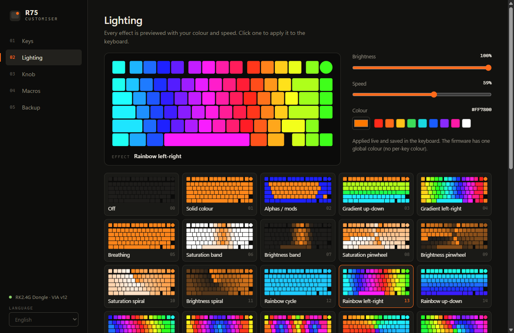
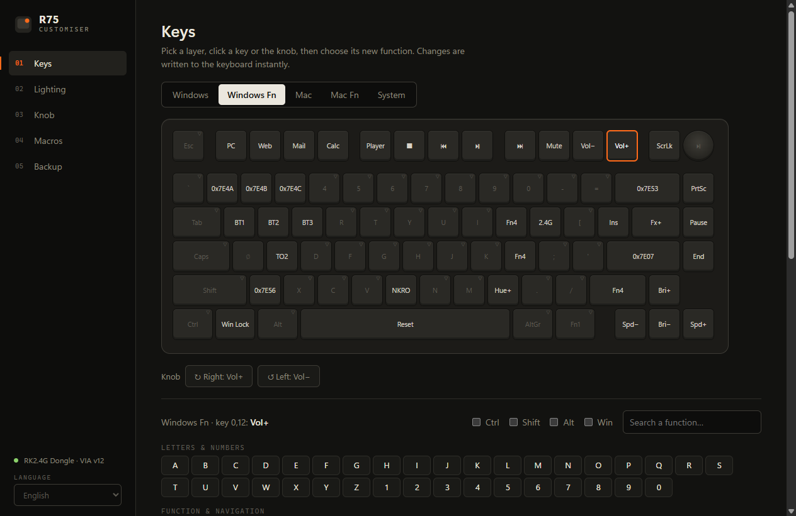
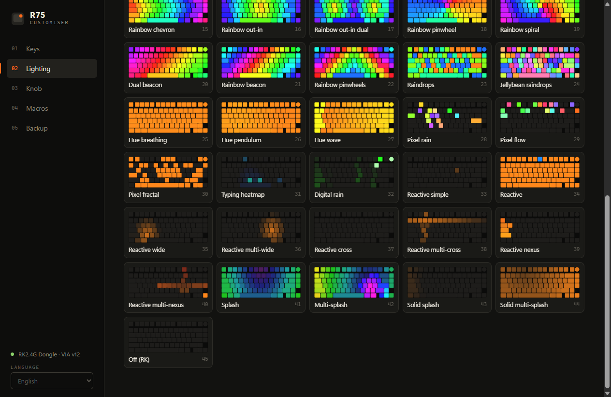
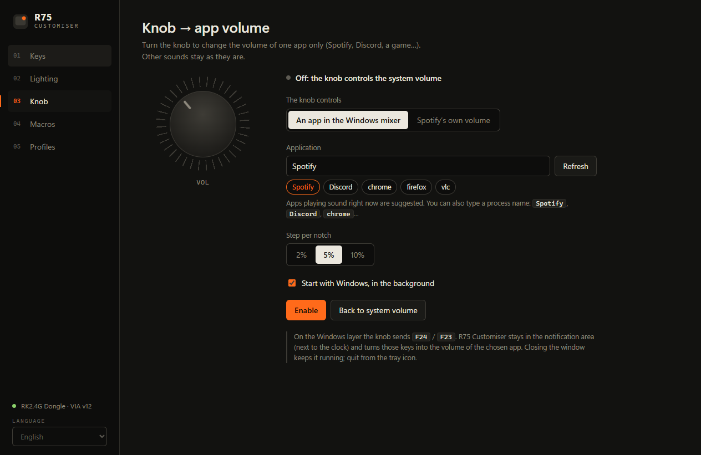
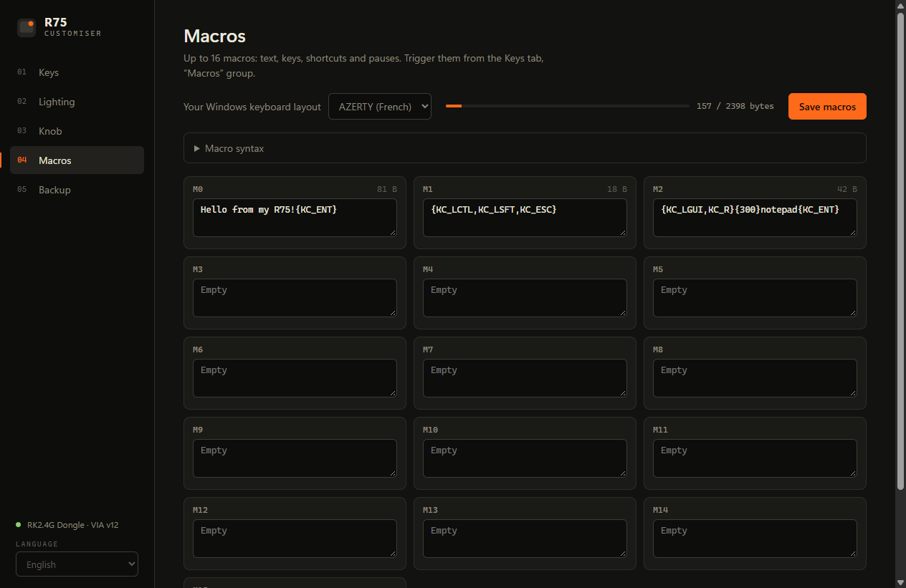
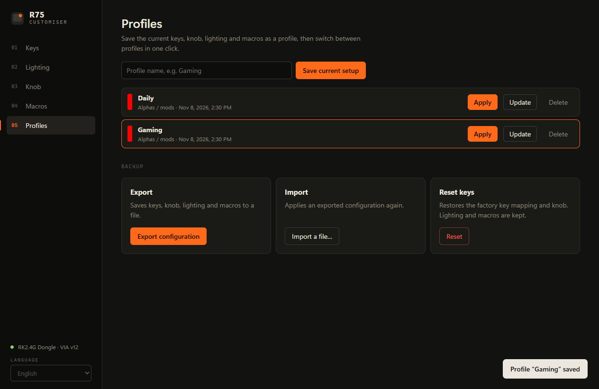
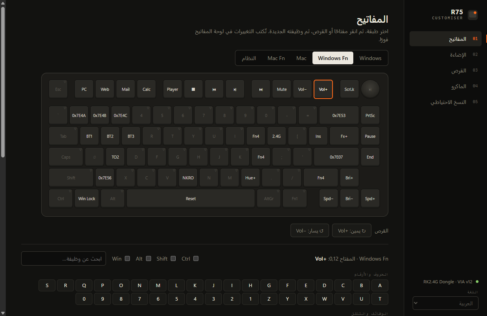
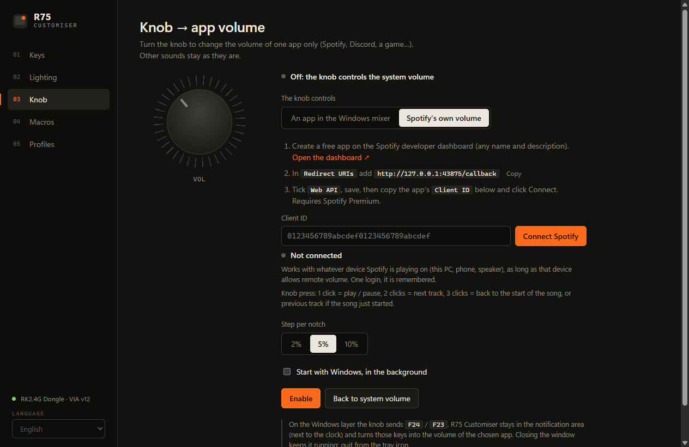

<p align="center">
  
</p>

<h1 align="center">R75 Customiser</h1>

<p align="center">
  <b>A fast, offline configurator for the Royal Kludge R75 keyboard.</b><br>
  Remap keys and Fn shortcuts, preview all 46 lighting effects, write macros,<br>
  and turn the knob into a volume dial for a single app like Spotify.
</p>

<p align="center">
  <a href="../../releases/latest"></a>
  
  
  
</p>

<p align="center"><a href="README.fr.md">Lire en français</a></p>

<p align="center">
  
</p>

## Why

The official RK web configurator is slow, needs a browser and often does not even detect the keyboard. R75 Customiser is a single portable `.exe`: plug in the keyboard, open the app, it is found instantly. No account, no installer, no internet.

## Features

| | |
|---|---|
| **Keys** | Remap any key on all 5 layers (Windows, Windows + Fn, Mac, Mac + Fn, System). Shortcuts like `Ctrl + Shift + Esc`, media keys, layer keys, lighting keys, macros and RK wireless functions (BT1 to BT5, 2.4 GHz, USB). |
| **Fn shortcuts** | Pick the *Windows Fn* layer and give every `Fn + key` the action you want. Keys you leave transparent show what they inherit. |
| **Lighting** | All 46 effects of the firmware, each with an animated preview using your colour. Previews are slowed down and only play on hover, to stay easy on the eyes (Windows *reduce animations* setting is respected). Click a preview to apply it. Brightness, speed and colour change the keyboard in real time and are saved to it. |
| **Knob → app volume** | Turn the knob to change the volume of one app only (Discord, a game, a browser...) in the Windows volume mixer, or drive **Spotify's own volume slider** through the Spotify Web API. A small on-screen bar shows the level. Other sounds are left alone. |
| **Macros** | 16 macros mixing text, keys, combinations and pauses. Text is converted for a French AZERTY or a US QWERTY Windows layout, accents included. |
| **Profiles** | Save the current setup (keys, knob, lighting, macros) as named profiles such as *Work* or *Gaming* and switch in one click. Only what differs is written to the keyboard. |
| **Backup** | Export the whole configuration to a JSON file and restore it later, or reset the keys to factory settings. |
| **5 languages** | English, Français, Español, Deutsch and العربية (with a full right-to-left layout). |

## Screenshots

<table>
  <tr>
    <td></td>
    <td></td>
  </tr>
  <tr>
    <td></td>
    <td></td>
  </tr>
  <tr>
    <td></td>
    <td></td>
  </tr>
</table>

## Getting started

1. Download from the [Releases](../../releases/latest) page: `R75-Customiser-x.y.z.exe` for Windows (portable, nothing to install) or `R75-Customiser-x.y.z-mac.dmg` for macOS (Intel and Apple Silicon).
2. Connect the keyboard with the **2.4 GHz dongle** or the **USB cable**. Bluetooth mode cannot be configured (the firmware does not expose its configuration interface over Bluetooth).
3. Run the app. The keyboard is detected automatically.

> **Windows SmartScreen** may warn you the first time because the app is not code-signed. Click *More info*, then *Run anyway*.

> **macOS**: open the `.dmg` and drag *R75 Customiser* to *Applications*. The app is not notarized by Apple, so the first launch is blocked: open *System Settings → Privacy & Security*, scroll down and click *Open Anyway* (or run `xattr -cr "/Applications/R75 Customiser.app"` in Terminal).

Wireless keyboard asleep? Press any key, then click *Find keyboard*.

## Knob → app volume


Two modes, picked at the top of the **Knob** tab:

**An app in the Windows mixer** (any app)

1. Start playing something in the app you want to control.
2. Pick the app (apps currently playing sound are suggested) and a step per notch.
3. Click **Enable**.

**Spotify's own volume** (Spotify Premium)

Moves the volume slider inside Spotify itself, on whatever device is playing (this PC, a phone, a speaker), with 1 % precision and without bringing Spotify to the front.

1. Open the [Spotify developer dashboard](https://developer.spotify.com/dashboard) and create an app (any name and description).
2. Add the redirect URI `http://127.0.0.1:43875/callback`, tick **Web API** and save.
3. Copy the app's **Client ID** into R75 Customiser, click **Connect Spotify** and approve in your browser. This is needed once; the login is remembered.
4. Click **Enable**.

In Spotify mode the knob press becomes a media button: **1 click** play / pause, **2 clicks** next track, **3 clicks** back to the start of the song, or to the previous track if the song has just started.

On macOS only Spotify mode is available (macOS has no per-app volume), and the knob is set on the **Mac layer** (`F18` / `F17`, press `F19`): switch the keyboard to Mac mode.

Each user creates their own Spotify app because Spotify only allows a handful of users per app in Development Mode, and requires the app owner to have Premium.

<br clear="right">

<p align="center"></p>

How it works: on the Windows layer the knob is set to send `F24` / `F23`, two keys no app uses. R75 Customiser keeps running in the notification area, catches those keys and changes the volume: through the Windows audio mixer in app mode, through the Spotify Web API in Spotify mode. Closing the window keeps it running; quit from the tray icon. With *Start with Windows* checked it starts silently at logon.

**Back to system volume** restores the factory knob (`Vol+` / `Vol−` and `Mute` on press) and stops the background mode.

## Compatibility

| | |
|---|---|
| Keyboard | Royal Kludge R75 (wireless version, QMK + VIA firmware, protocol 12) |
| Connection | 2.4 GHz dongle (tested, `VID 0x342D` / `PID 0xE485`) or USB cable |
| System | Windows 10 and 11, 64-bit; macOS 12 or newer (Intel and Apple Silicon) |

Other RK boards running QMK/VIA may be detected but use a different key layout: not supported.

## Build from source

Requires [Node.js](https://nodejs.org) 20 or newer.

```bash
npm install
npm test        # offline checks: protocol, macros, layout, translations, effect previews
npm start       # run the app in development
npm run dist    # build dist/R75-Customiser-<version>.exe (portable)
npm run dist:mac  # on a Mac: build dist/R75-Customiser-<version>-mac.dmg (universal)
```

## How it works

- **Electron + WebHID**, no native module. The main process grants and selects the Royal Kludge device (`VID 0x342D`) exposing the QMK raw HID interface (usage page `0xFF60`), so there is no device picker.
- **VIA protocol v12**: dynamic keymap, encoder, `qmk_rgb_matrix` lighting (channel 3) and macro buffer. Every change is written to the keyboard memory, so it keeps working on any computer without the app.
- **Effect previews** re-implement the QMK RGB matrix animations on a canvas; reactive effects are fed with simulated key presses.
- **Per-app volume** uses the Windows Core Audio API (`ISimpleAudioVolume`) from a small PowerShell helper (`src/audio.ps1`) started only when the knob feature is used.
- **Spotify mode** uses the Authorization Code flow with PKCE (no client secret) on a loopback redirect, then `PUT /v1/me/player/volume`. The refresh token is encrypted with Windows DPAPI (Electron `safeStorage`) in the app data folder.
- The RK VIA definition file has layout errors (backslash and knob swapped, bottom row shifted). The layout here is rebuilt from the real firmware matrix.
- Undocumented RK keycodes (such as `0x7E4A`) are shown in hex and kept as they are.

## Limitations

- One global lighting colour: the stock wireless R75 firmware does not expose per-key RGB. Community QMK firmwares with per-key RGB exist for the wired R75 only; flashing them on the wireless model would at least break wireless and can brick the board, so they are not supported here.
- Macro text conversion supports AZERTY (French) and QWERTY (US) Windows layouts. With other layouts (and Mac layouts, whose symbols differ), use `{KC_...}` key names.
- The macOS build is made on GitHub's macOS runners and is not notarized; it has not been tested on as many machines as the Windows build.
- The knob → app volume feature needs the app running in the background, and only applies to the Windows layer.
- Spotify mode needs Spotify Premium and an internet connection, and only works on devices that allow remote volume (some phones and TVs do not).

## Privacy

The app works offline and only talks to the keyboard over USB. The one exception is Spotify mode, if you turn it on: it then talks to Spotify's servers (`accounts.spotify.com`, `api.spotify.com`) with your own Client ID, only to read and set the playback volume.

## License

[MIT](LICENSE). Unofficial project, not affiliated with Royal Kludge.
